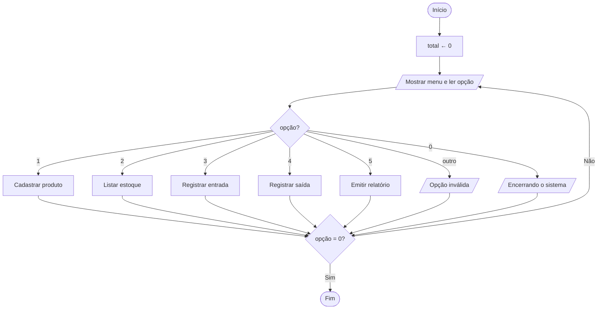
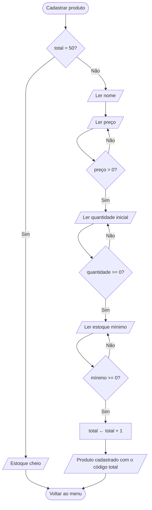
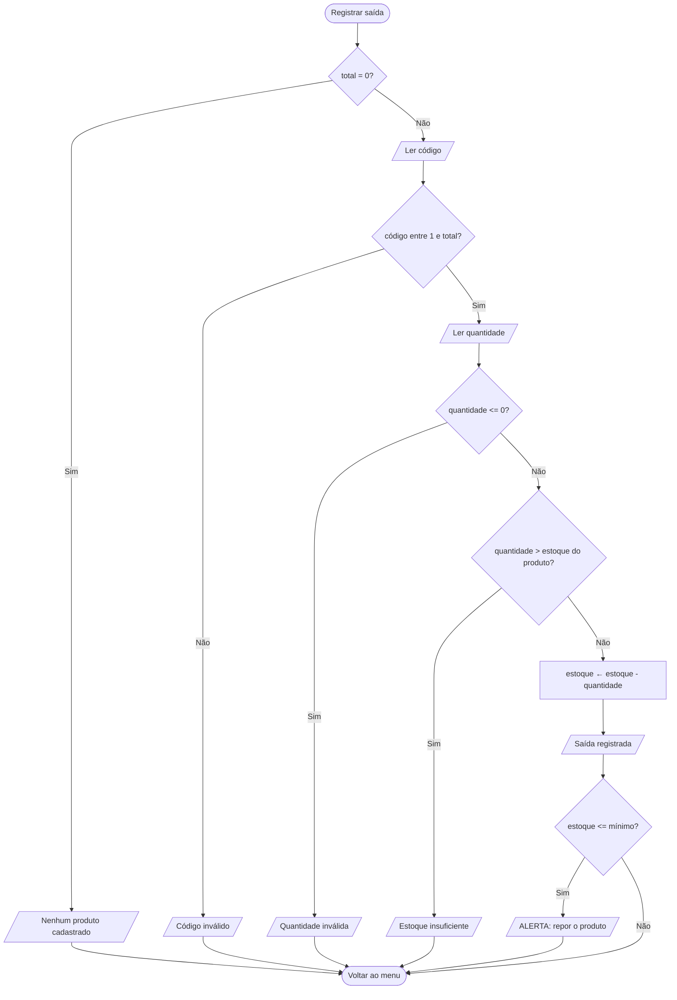
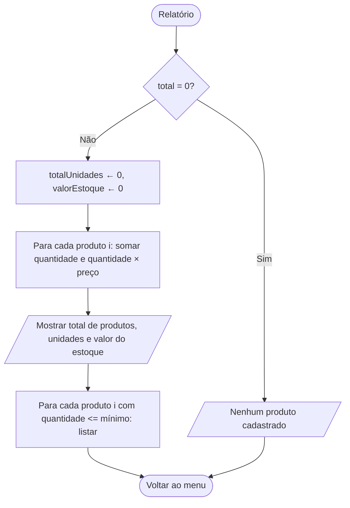

# Desafio Final - Do Problema ao Algoritmo

**Tema escolhido:** Controle de estoque
**Disciplina:** Lógica de Programação e Algoritmos
**Implementação em C:** [`../src/desafio_final_controle_estoque.c`](../src/desafio_final_controle_estoque.c)

---

## 1. Descrição do problema

Uma pequena loja precisa controlar os produtos que mantém em estoque. Hoje o controle é feito de
cabeça ou em papel, o que causa dois problemas frequentes:

- vender um produto que já acabou, porque ninguém sabia a quantidade real;
- esquecer de repor um produto, que só é percebido quando a prateleira já está vazia.

O sistema deve permitir **cadastrar produtos**, **registrar as entradas** (mercadoria que chegou) e as
**saídas** (mercadoria vendida), **consultar o estoque** e emitir um **relatório** com o valor total
guardado e os produtos que precisam ser repostos. Cada produto tem um **estoque mínimo**: quando a
quantidade chega a esse valor (ou fica abaixo dele), o sistema avisa que é hora de repor.

Regras do sistema:

- cada produto recebe um código automático, na ordem de cadastro (1, 2, 3...);
- cabem até 50 produtos;
- não é permitido registrar saída maior que a quantidade em estoque (o estoque nunca fica negativo);
- preço deve ser maior que zero; quantidades e estoque mínimo não podem ser negativos;
- o programa continua em execução, mostrando o menu, até o usuário escolher a opção Sair.

---

## 2. Entradas necessárias

| Entrada | Tipo | Quando é informada | Validação |
|---|---|---|---|
| `opcao` | inteiro | a cada volta do menu | 0 a 5 (outro valor mostra "Opção inválida") |
| `nome` | texto | cadastro | - |
| `preco` | real | cadastro | maior que zero |
| `quantidade` (inicial) | inteiro | cadastro | maior ou igual a zero |
| `minimo` | inteiro | cadastro | maior ou igual a zero |
| `cod` | inteiro | entrada e saída | entre 1 e o total de produtos cadastrados |
| `qtd` | inteiro | entrada e saída | maior que zero; na saída, não pode passar do estoque |

---

## 3. Processamento

1. **Cadastrar:** guarda nome, preço, quantidade inicial e estoque mínimo na próxima posição livre dos
   vetores e aumenta o contador `total`.
2. **Listar:** percorre os produtos e, para cada um, calcula `valor = quantidade × preço` e define a
   situação: `REPOR` se `quantidade <= minimo`, senão `OK`.
3. **Entrada:** `quantidade[cod - 1] ← quantidade[cod - 1] + qtd`.
4. **Saída:** se `qtd > quantidade[cod - 1]`, recusa a operação; senão faz
   `quantidade[cod - 1] ← quantidade[cod - 1] - qtd` e, se o novo valor for menor ou igual ao mínimo,
   emite alerta de reposição.
5. **Relatório:** acumula `totalUnidades` (soma das quantidades) e `valorEstoque` (soma de
   `quantidade × preço`) e lista os produtos com `quantidade <= minimo`.

---

## 4. Saídas esperadas

- confirmação do cadastro, com o código do produto;
- tabela do estoque: código, produto, quantidade, preço, valor em estoque e situação (`OK`/`REPOR`);
- confirmação de entrada e de saída, mostrando o novo estoque do produto;
- alerta quando um produto atinge o estoque mínimo;
- mensagens de erro: código inválido, quantidade inválida, estoque insuficiente, estoque cheio, nenhum
  produto cadastrado;
- relatório: produtos cadastrados, total de unidades, valor total do estoque e lista de produtos para repor.

---

## 5. Pseudocódigo completo

```text
ALGORITMO ControleDeEstoque

CONSTANTE MAX_PRODUTOS = 50

VARIAVEIS
    nome[MAX_PRODUTOS]       : texto
    quantidade[MAX_PRODUTOS] : inteiro
    minimo[MAX_PRODUTOS]     : inteiro
    preco[MAX_PRODUTOS]      : real
    total, opcao, cod, qtd, i : inteiro
    totalUnidades, precisaRepor : inteiro
    valorEstoque : real

INICIO
    total <- 0

    REPITA
        ESCREVA "1.Cadastrar 2.Listar 3.Entrada 4.Saida 5.Relatorio 0.Sair"
        LEIA opcao

        ESCOLHA opcao

            CASO 1  // cadastrar produto
                SE total = MAX_PRODUTOS ENTAO
                    ESCREVA "Estoque cheio!"
                SENAO
                    LEIA nome[total]
                    REPITA LEIA preco[total]      ATE preco[total] > 0
                    REPITA LEIA quantidade[total] ATE quantidade[total] >= 0
                    REPITA LEIA minimo[total]     ATE minimo[total] >= 0
                    total <- total + 1
                    ESCREVA "Produto cadastrado com o codigo ", total
                FIM-SE

            CASO 2  // listar estoque
                SE total = 0 ENTAO
                    ESCREVA "Nenhum produto cadastrado."
                SENAO
                    PARA i DE 0 ATE total - 1 FACA
                        SE quantidade[i] <= minimo[i] ENTAO
                            situacao <- "REPOR"
                        SENAO
                            situacao <- "OK"
                        FIM-SE
                        ESCREVA i + 1, nome[i], quantidade[i], preco[i],
                                quantidade[i] * preco[i], situacao
                    FIM-PARA
                FIM-SE

            CASO 3  // registrar entrada
                SE total = 0 ENTAO
                    ESCREVA "Nenhum produto cadastrado."
                SENAO
                    LEIA cod
                    SE cod < 1 OU cod > total ENTAO
                        ESCREVA "Codigo invalido!"
                    SENAO
                        LEIA qtd
                        SE qtd <= 0 ENTAO
                            ESCREVA "Quantidade invalida!"
                        SENAO
                            quantidade[cod - 1] <- quantidade[cod - 1] + qtd
                            ESCREVA "Entrada registrada. Estoque: ", quantidade[cod - 1]
                        FIM-SE
                    FIM-SE
                FIM-SE

            CASO 4  // registrar saida
                SE total = 0 ENTAO
                    ESCREVA "Nenhum produto cadastrado."
                SENAO
                    LEIA cod
                    SE cod < 1 OU cod > total ENTAO
                        ESCREVA "Codigo invalido!"
                    SENAO
                        LEIA qtd
                        SE qtd <= 0 ENTAO
                            ESCREVA "Quantidade invalida!"
                        SENAO SE qtd > quantidade[cod - 1] ENTAO
                            ESCREVA "Estoque insuficiente! Disponivel: ", quantidade[cod - 1]
                        SENAO
                            quantidade[cod - 1] <- quantidade[cod - 1] - qtd
                            ESCREVA "Saida registrada. Estoque: ", quantidade[cod - 1]
                            SE quantidade[cod - 1] <= minimo[cod - 1] ENTAO
                                ESCREVA "ALERTA: atingiu o estoque minimo. Repor!"
                            FIM-SE
                        FIM-SE
                    FIM-SE
                FIM-SE

            CASO 5  // relatorio
                SE total = 0 ENTAO
                    ESCREVA "Nenhum produto cadastrado."
                SENAO
                    totalUnidades <- 0
                    valorEstoque  <- 0
                    precisaRepor  <- 0
                    PARA i DE 0 ATE total - 1 FACA
                        totalUnidades <- totalUnidades + quantidade[i]
                        valorEstoque  <- valorEstoque + quantidade[i] * preco[i]
                    FIM-PARA
                    ESCREVA total, totalUnidades, valorEstoque
                    PARA i DE 0 ATE total - 1 FACA
                        SE quantidade[i] <= minimo[i] ENTAO
                            ESCREVA nome[i], quantidade[i], minimo[i]
                            precisaRepor <- precisaRepor + 1
                        FIM-SE
                    FIM-PARA
                    SE precisaRepor = 0 ENTAO
                        ESCREVA "(nenhum)"
                    FIM-SE
                FIM-SE

            CASO 0
                ESCREVA "Encerrando o sistema."

            OUTRO CASO
                ESCREVA "Opcao invalida!"

        FIM-ESCOLHA

    ATE opcao = 0
FIM
```

---

## 6. Fluxogramas

> Os fluxogramas abaixo são desenhados com Mermaid, que o GitHub exibe automaticamente.

### 6.1 Fluxo geral do sistema



### 6.2 Cadastrar produto



### 6.3 Registrar saída



### 6.4 Emitir relatório



---

## 7. Teste de mesa

Os testes abaixo seguem **uma única execução do programa**, em sequência, então o estado de um cenário
continua no seguinte. Os resultados foram conferidos executando o programa em C.

### Cenário 1 - Operação normal: cadastro, entrada e saída

| Passo | Entrada | O que o algoritmo faz | Variáveis depois | Saída |
|---|---|---|---|---|
| 1 | opção `1`; nome `Arroz 5kg`, preço `25.00`, quantidade `20`, mínimo `5` | cadastra na posição 0 | `total = 1`; `quantidade[0] = 20` | Produto cadastrado com o codigo 1. |
| 2 | opção `3`; código `1`; qtd `10` | código válido; `20 + 10` | `quantidade[0] = 30` | Entrada registrada. Estoque de Arroz 5kg: 30 unidade(s). |
| 3 | opção `4`; código `1`; qtd `12` | `12 > 30`? Não. `30 - 12`. `18 <= 5`? Não | `quantidade[0] = 18` | Saida registrada. Estoque de Arroz 5kg: 18 unidade(s). |

### Cenário 2 - Saída maior que o estoque

| Passo | Entrada | O que o algoritmo faz | Variáveis depois | Saída |
|---|---|---|---|---|
| 1 | opção `4`; código `1`; qtd `50` | `50 > 18`? Sim, recusa a saída | `quantidade[0] = 18` (não muda) | Estoque insuficiente! Disponivel: 18 unidade(s). |

### Cenário 3 - Código inválido

| Passo | Entrada | O que o algoritmo faz | Variáveis depois | Saída |
|---|---|---|---|---|
| 1 | opção `4`; código `9` | `9 > total` (que vale 1), recusa e nem pede a quantidade | nada muda | Codigo invalido! |

### Cenário 4 - Alerta de reposição e relatório

| Passo | Entrada | O que o algoritmo faz | Variáveis depois | Saída |
|---|---|---|---|---|
| 1 | opção `1`; nome `Feijao 1kg`, preço `8.50`, quantidade `10`, mínimo `4` | cadastra na posição 1 | `total = 2`; `quantidade[1] = 10` | Produto cadastrado com o codigo 2. |
| 2 | opção `4`; código `2`; qtd `7` | `7 > 10`? Não. `10 - 7 = 3`. `3 <= 4`? Sim | `quantidade[1] = 3` | Saida registrada. Estoque de Feijao 1kg: 3 unidade(s). **ALERTA**: Feijao 1kg atingiu o estoque minimo (4). Repor! |
| 3 | opção `2` | lista os produtos | - | Arroz 5kg, 18, 25.00, 450.00, **OK**; Feijao 1kg, 3, 8.50, 25.50, **REPOR** |
| 4 | opção `5` | `totalUnidades = 18 + 3`; `valorEstoque = 18×25 + 3×8,50` | `totalUnidades = 21`; `valorEstoque = 475.50` | Produtos cadastrados: 2; Total de unidades: 21; Valor total: R$ 475.50; Produtos para repor: Feijao 1kg (estoque: 3 / minimo: 4) |

### Cenário 5 - Sistema vazio

Ao iniciar o programa, com `total = 0`:

| Entrada | O que o algoritmo faz | Saída |
|---|---|---|
| opção `2`, `3`, `4` ou `5` | `total = 0`, não há o que mostrar nem alterar | Nenhum produto cadastrado. |

---

## 8. Explicação da solução

**Estrutura de dados.** O programa usa quatro vetores paralelos (`nome`, `quantidade`, `minimo` e
`preco`). A posição `i` de cada vetor descreve o mesmo produto, e o código mostrado ao usuário é
simplesmente `i + 1`. Essa escolha mantém o programa simples, adequado ao conteúdo da disciplina, e
permite achar um produto direto pelo código, sem precisar pesquisar.

**Controle do fluxo.** Um laço `REPITA...ATÉ` (`do...while` em C) mostra o menu até o usuário escolher
Sair. Dentro dele, um `ESCOLHA` (`switch`) decide qual operação executar, o que deixa cada
funcionalidade separada e fácil de entender.

**Validação.** Os dados são conferidos antes de serem usados: preço positivo, quantidades não negativas,
código dentro do intervalo cadastrado e, principalmente, saída nunca maior que o estoque, o que garante
que a quantidade em estoque jamais fique negativa.

**Estoque mínimo.** Cada produto tem seu próprio limite. A comparação `quantidade <= minimo` é usada em
três lugares (alerta na saída, coluna `SITUACAO` da listagem e lista do relatório), de modo que o aviso de
reposição aparece quando e onde o usuário precisa dele.

**Limitações.** Os dados ficam só na memória: ao fechar o programa, o estoque é perdido. Também não há
opção para editar ou remover um produto cadastrado. Como melhoria futura, daria para gravar os dados em
arquivo e acrescentar essas duas opções ao menu.
